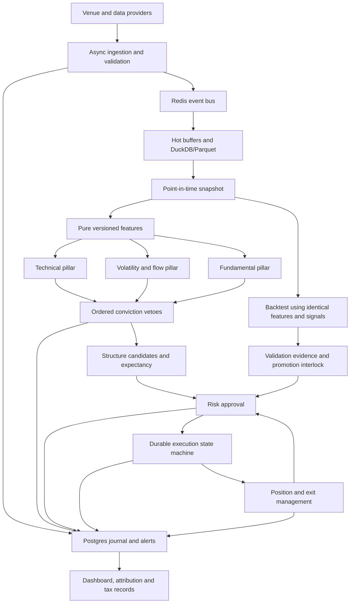

# Selective high-conviction options system

Status: milestone 1 readiness passed; milestone 2 ingestion pilot implemented in part. Later trading interfaces remain design contracts; the initial feature and offline accounting modules are implemented independently, with acceptance pending. Trading is disabled in this build in every profile. No live or testnet orders can be submitted.

## Mission and boundaries

Stay flat by default. Optimise expectancy after costs, never standalone win rate or trade count. Risk has final veto. Missing, stale, contradictory or unverified evidence must prevent entry. Zero trades is valid.

Milestone acceptance follows the requested order. The direct human instruction on 5 October permits independent feature/backtester implementation alongside ingestion, documented in WORK_LOG.md; it does not accept later milestones. Public testnet discovery can be demonstrated without credentials. Authenticated startup and an early real refresh grant have now passed against testnet. Milestone 2 additionally needs data-provider choices and credentials, including historical bid/ask data. No later milestone is claimed complete on the basis of fixtures.



## Implemented milestone 1 interfaces

See `src/selective_options/` for authoritative type definitions.

| Module | Interface | Responsibility |
| --- | --- | --- |
| config | `load_config(config_dir: Path, profile: str) -> AppConfig` | Typed YAML, deep profile merge, environment overrides, cross-field validation |
| security | `load_credentials(profile: str) -> Credentials` | Environment-specific secrets; no fallback across profiles |
| security | `verify_key_scope(scope: str) -> None` | Reject withdrawal and account-management permission; require trading permission |
| logging | `configure_logging(level: str) -> None` | Structured logs; scrub known secrets and credential fields |
| rate_limit | `TokenBucket.acquire(cost: float) -> None` (async) | Separate discovery, subscription and ordinary credit budgets |
| rpc | `RpcClient.call(method: str, params: dict[str, JsonValue]) -> JsonValue` (async) | Validated JSON-RPC 2.0 over WebSocket; bounded deadlines; public/readiness allowlist |
| venue | `VenueAdapter.discover(asset: str) -> DiscoveryResult` (async) | Dynamic instruments; explicit fallback to `currency=any` only on unsupported-currency error |
| venue | `VenueAdapter.option_chain(asset: str) -> ChainSnapshot` (async) | Join discovered instruments with bid/ask summaries, report missing quotes |
| venue | `VenueAdapter.ticker(instrument_name: str) -> Ticker` (async) | Typed timestamped greeks and best bid/ask |
| auth | `AuthSession.authenticate() -> None`, `ensure_fresh() -> None` (async) | Validate maximum API-key scope, refresh before expiry, verify pre-enabled connection cancel-on-disconnect |
| startup | `probe(config: AppConfig, authenticated: bool) -> ProbeReport` (async) | Public testnet readiness evidence, clock skew and capability report |
| interlock | `LiveEngine.arm() -> None` | Always raises `TradingUnavailable` until trading and all promotion gates exist |

## Implemented ingestion interfaces

`capture(config, output, duration_s)` runs finite public collectors, a bounded queue and durable writer. `ChannelRegistry` normalizes Deribit notifications; `SpotCollector` discovers Coinbase/Kraken products. `DuckStore.append`, `snapshot` and `export_parquet` implement transactional storage, point-in-time reads and immutable exports. `FreshnessMonitor` reports aggregate age and reference divergence. `DerivativesCollector` discovers public perpetual contracts, retains their quote/settlement metadata, and records funding plus closed BTC/ETH volatility-index candles. `RedisMirror` is an optional output mirror, not the complete bus pictured above. See INGESTION_STATUS.md for remaining M2 work and evidence.

## Planned interfaces (milestones 2–13)

These contracts are deliberately not executable placeholders.

```python
class Collector(Protocol):
    def events(self) -> AsyncIterator[MarketEvent]: ...


class EventBus(Protocol):
    async def publish(self, event: MarketEvent) -> None: ...
    def subscribe(self, topics: set[str]) -> AsyncIterator[MarketEvent]: ...


class HistoricalStore(Protocol):
    async def append(self, events: Sequence[MarketEvent]) -> None: ...
    async def snapshot(self, asset: Asset, as_of: datetime) -> PointInTimeSnapshot: ...


class PointInTimeSnapshot(Protocol):
    # Returned rows require event_time <= as_of AND observed_at <= as_of.
    # Closed bars additionally require close_time <= as_of.
    def rows(self, source: str, since: datetime) -> tuple[MarketEvent, ...]: ...


def compute_features(snapshot: PointInTimeSnapshot, config: FeatureConfig) -> FeatureSet: ...
def classify_regime(features: FeatureSet, previous: Regime) -> Regime: ...
def technical(snapshot: PointInTimeSnapshot, features: FeatureSet) -> PillarResult: ...
def volatility_flow(snapshot: PointInTimeSnapshot, features: FeatureSet) -> VolPillarResult: ...
def fundamental(snapshot: PointInTimeSnapshot, features: FeatureSet) -> PillarResult: ...
def evaluate_gate(context: DecisionContext, pillars: Pillars) -> GateDecision: ...
def estimate_expectancy(candidate: Structure, history: Analogues, costs: Costs) -> Expectancy: ...
def calibrate(trades: Sequence[ClosedTrade]) -> CalibrationArtifact: ...
def enumerate_structures(
    context: DecisionContext, chain: ChainSnapshot
) -> tuple[Structure, ...]: ...
def size_and_approve(
    candidate: Structure, portfolio: Portfolio, state: RiskState
) -> RiskDecision: ...
def stress_test(portfolio: Portfolio, shocks: ShockConfig, seed: int) -> TailReport: ...


class ExecutionEngine(Protocol):
    async def execute(self, approval: RiskApproval, exit_plan: ExitPlan) -> ExecutionResult: ...
    async def reconcile(self) -> ReconciliationResult: ...
    async def halt(self, flatten: bool) -> HaltResult: ...


def evaluate_exit(position: Position, context: DecisionContext) -> ExitDecision: ...
def backtest(
    events: Iterable[MarketEvent], strategy: Strategy, config: BacktestConfig
) -> TrialResult: ...
def validate(trials: TrialRegistry, paper: PaperLedger) -> ValidationArtifact: ...
def can_arm(artifact: ValidationArtifact, halt: HaltState, now: datetime) -> ArmDecision: ...


class Journal(Protocol):
    async def record_decision(self, decision: FullDecisionRecord) -> None: ...
    async def record_fill(self, fill: ActualFillCosts) -> None: ...


def monthly_attribution(trades: Sequence[ClosedTrade]) -> AttributionReport: ...
def export_tax_csv(transactions: Sequence[Transaction], fx: HistoricalFX) -> str: ...
```

## Decisions and unresolved specification conflicts

1. Preserve event time **and** first-observed time. First publication alone permits lookahead when news arrived late. Corrections are new versions, never overwrites.
2. Currency filters are not a stable underlying registry. Always match returned `base_currency`; preserve quote currency, settlement currency, contract size, minimum amount and tick-size steps. Do not parse economics from names.
3. A perpetual stop is not a guaranteed maximum loss during a gap. Synthetic gold must never be labelled defined-risk or premium-equivalent. It remains unavailable until the operator selects a broker/risk policy and gap stress treatment is validated. No implicit synthetic substitution.
4. GEX requires assumptions about dealer inventory. Open interest does not reveal dealer sign. Mark inferred GEX as such and refuse to present it as observed positioning.
5. Neutral-volatility strategies conflict with the all-three-directional-pillars gate. They remain disabled until separate movement/range evidence contracts are specified and tested; directional gates are not relaxed.
6. Calendar/diagonal risk cannot use the vertical spread-width formula. Require exercise/settlement and path-dependent risk modelling before enabling them.
7. Deduct each cost exactly once: gross payoff expectancy less spread, fees, slippage and financing. Publish the arithmetic and denomination.
8. TDS is normally a withholding/receivable and cash-flow constraint, not automatically a permanent P&L expense. Tax applicability to offshore derivatives requires professional confirmation. Planned reports separate tax liability, withholding and financing drag.
9. DSR means a statistical confidence criterion, not a raw Sharpe threshold. Library selection, sample adequacy and methodology must be pinned in milestone 11. Do not fabricate PBO/DSR from synthetic fixtures.
10. The prompt's monthly-stop reference to §10 validation is interpreted as §11. Clearance requires fresh validation after the halt plus documented review; it cannot be a boolean config override.
11. Gamma notional and tail-loss caps are unspecified. They remain `null` configuration values, blocking future execution until explicitly set with units.
12. Locally labelling a secret “testnet” cannot prove its origin. Use disjoint environment namespaces and exact endpoint/profile checks; authentication to that endpoint is the authoritative check. Never fall back to production.
13. Discovery does not prove tradability. Full leg-level depth, spread, staleness and sizing gates belong to milestones 7–8; the first milestone labels all assets non-tradable.
14. Deribit's documented `enable_cancel_on_disconnect` requires `account:read_write`, conflicting with the requested trading-only runtime key. Runtime keys therefore have `account:read` for inspection, `trade:read_write`, and no wallet write scope. The operator must first enable the account COD default through account administration; startup verifies it for the actual connection. If key-list inspection requires additional authentication/TFA, startup halts rather than treating reduced token scope as proof of safe maximum scope. These paths need real account testing.

## Milestone advancement

M1: local tests + public testnet chain probe + authenticated key-scope/refresh/COD check. M2: all required feeds flowing and replayable with timestamp provenance. Then follow milestones 3–14 in the supplied prompt. Every report distinguishes fixture tests, current venue evidence and long-running operational evidence. No promotion data can be substituted with demonstrations.

## Version 0.3.1 ingestion/recovery implementation

`SpotTradeCollector` discovers Kraken v2 pairs and validates native trade sequences. `TradeBars` derives closed UTC candles and flags partial coverage; `ClosedBarPayload` prevents source/observation-time disguises. `PolicyNewsCollector` stores official RSS metadata with publication/observation separation and independent feed-health events. `FreshnessMonitor.option_freshness` checks each selected option.

`DuckStore` commits event records and delivery-outbox entries together. Redis delivery is acknowledged only after publish; `replay_pending` is at-least-once. `archive.seal_archive` writes integrity manifests, and `restore_archive` validates and stages a fresh database before publishing it. Event archives do not include Redis acknowledgements, so restored records are pending again. These recovery functions do not repair an unrecorded market-data interval or implement a complete consumer bus.

## Version 0.3.2 Kraken sequence checkpoint

`load_trade_checkpoints` reads a stopped capture database without migration, selecting the last 50 native IDs per requested book. It validates typed payloads, canonical event identities and contiguous sequences. The committed event journal is the checkpoint: there is no separate cursor that could advance before data commits. A new capture seeds these records atomically with original observation times and fresh pending-delivery entries.

`SpotTradeCollector` seeds its sequence cache, discovers current symbols, validates snapshot overlap, and accepts consecutive new IDs at their actual observation time. It validates a whole sequence batch before publishing its first trade. Recovery snapshots must reach the previous high-water mark; uncovered gaps and conflicting duplicates halt. No-checkpoint startup is explicitly labelled `TRADE_SNAPSHOT_INITIALIZED`. Per-book bar flush waits for snapshots after reconnect; bars and non-Kraken sources are not restored.

Kraken documents a snapshot of the most recent 50 trades and per-book trade IDs: [official trade channel](https://docs.kraken.com/exchange/api-reference/spot-websocket-v2/trade). These properties bound this recovery method; broader historical backfill remains outstanding.

## Version 0.3.3 explicit REST coverage

`trade_backfill.backfill_trades` derives an anchor from committed Kraken WebSocket events and fetches a caller-specified inclusive end ID. `/0/public/Trades` uses `assetVersion=1`, a `since` cursor and bounded `count`. A one-second lookback includes the checkpoint despite transport timestamp precision differences. The known anchor must match price, quantity, side and source time within one microsecond; this tolerance is solely for comparing the WebSocket datetime with the higher-precision REST timestamp.

JSON numbers are parsed as Decimal. REST timestamps, prices and quantities retain their exact returned decimal representations; normalized millisecond event time is floored from the decimal timestamp. Records use `kraken_rest` to avoid silently changing WebSocket event identity. Each page's receipt time is retained, overlap is deduplicated by native ID and payload, and only a complete consecutive range is published to an event archive. HTTP redirects are disabled; only the fixed public endpoint is used. Page count/size, response bytes, request timeout, total fetch timeout and inter-page pacing bound resource use.

The next recovery step must explicitly reconcile these verified ranges with live buffering and native-ID deduplication across transports. Until then, WebSocket gaps beyond its snapshot still fail, and `stream_repaired=false`/`bars_rebuilt=false` remain explicit. [Kraken REST trade documentation](https://docs.kraken.com/api-reference/market-data/get-recent-trades).

## Version 0.3.4 reconciliation and availability boundary

`TradeIdentity` verifies a raw event against its canonical transport schema and compares native ID, price, quantity, side and source time. REST decimal values remain exact. Timestamp tolerance is zero within a transport and one microsecond across REST/WebSocket, consistent with the existing anchor comparison. Both transport identities are retained per ID so tolerance cannot chain through another transport to disguise two conflicting WebSocket records.

`RecoveryBuffer` holds all bounded raw observations and chooses the earliest observed matching record per native ID with deterministic ties. A complete plan spans anchor+1 through at least the requested end and every buffered later ID. Missing middle/tail IDs, a conflict or overflow invalidate the attempt permanently. The plan is immutable and contains the untouched selected records plus a separate verification time. `ready_rows` rejects use before verification or while source/receipt times lie in the future.

`reconcile_while_receiving` concurrently pumps normalized received events and awaits a bounded backfill callback. On success it stops and joins the receiver, validates the fetched records, and produces one plan. On failure/deadline/cancellation it joins both tasks and marks the buffer failed. At version 0.3.4 this was a standalone tested component. Journal publication and explicit startup handoff follow below; automatic fetch orchestration is still pending. Never disguise REST rows as WebSocket events to satisfy existing source-specific validators.

## Version 0.3.5 atomic recovery evidence

`recovery_journal.publish_recovery` replays validation from the supplied anchor/raw records and compares the derived earliest-observed selection to the submitted plan. A canonical marker embeds anchor/high-water IDs, ordered evidence and selected event IDs, verification time and a SHA-256 digest that includes every persisted receipt timestamp. Duplicate observations of a stable ID are reduced to the first observation; raw transport identities are never relabelled.

`DuckStore.append(..., exact=True)` checks incoming and already-stored rows inside the transaction. A conflict rolls back the entire batch. Events, marker and delivery entries therefore become durable together; publication returns only after commit. Identical retries retain existing delivery acknowledgements. Ordinary `append` still has its original first-stored dedup behavior.

`load_recovery` reads an explicit marker without migration, requires every referenced record, reconstructs the bounded plan, recomputes the canonical marker/evidence digest, and checks time availability. Archive restore preserves marker and event records through the existing event schema. The marker stores verification time rather than physical commit time and does not constitute an active runtime cursor. Legacy WebSocket checkpoint loading is unchanged; version 0.3.6 adds an explicitly selected startup path below.

## Version 0.3.6 explicit runtime handoff

Capture validates an explicitly selected marker in the source database, publishes its unchanged anchor/raw/marker into a new destination, closes the destination, and calls `handoff_recovery` to reload that committed evidence. Only then does it open the writer and start producers. Cancellation during load leaves no sequence state; cancellation after publication leaves a restartable evidence database. Fresh-collector checks run both before and after the asynchronous reload.

`RecoveredSequence` retains up to 2,000 selected native IDs and both raw transport identities where available. Duplicate checks use exact economics and the existing zero-within/one-microsecond-across-transport timestamp rules. Every future native ID must be consecutive. Snapshot batch preflight still operates on a deep copy, preserving state on a later conflict or gap. Recovered REST events stay in their original source and never enter WebSocket bar builders. Bars start empty and partial, and flushing waits for a valid snapshot.

A marker resumes one explicit book and through-ID. It does not silently incorporate newer source records or recover other books. Automatic live receive/backfill orchestration, recovery of active bar state and other stream checkpoints remain M2 work.

## Version 0.3.7 gap publication while capture storage remains open

`recover_trade_gap` owns one bounded book attempt, from initial gap-triggering observations through concurrent live receive/REST fetch, validation, journal publication and reload. It uses existing page/time/byte/event limits and preserves every actual receipt. The receive callback must be exclusively routed by its caller and supply only that book; other-book handling and socket frame routing remain collector integration work. After the receive pump stops, pending socket frames still require ordinary native-ID checks. The coordinator does not touch collector state, bars, hot buffers or Redis consumers.

`DuckStore.read_events` serializes a bounded ID lookup with the existing writer lock and cancellation-safe thread helper. `load_committed_recovery` uses the same canonical marker/evidence checks as file reload, without opening an incompatible read-only connection alongside the writer. Event rows are immutable through the application API; append-only concurrent producers cannot change referenced evidence between lookups. Missing records or changed content fail verification.

The REST fetcher now verifies either source's canonical anchor identity. REST-to-REST anchor comparison has zero timestamp tolerance and preserves decimal nanoseconds in its cursor; the existing WebSocket-to-REST comparison retains its one-microsecond tolerance. All publication and reload failures leave activation to the caller. If cancellation interrupts publication before it returns, the report states the outcome is unknown; operators must inspect committed evidence before retrying. A failure after publication records the committed marker for explicit recovery.

## Version 0.3.8 collector suspension and consumer barrier

`EventBus.flush` inserts a bounded FIFO commit barrier into the normal event queue. The consumer stops draining at that barrier, persists its preceding batch, completes configured Redis delivery/outbox acknowledgement and hot/freshness updates, then acknowledges the barrier. Normal event publication remains asynchronous and batched; there is no per-trade synchronous write. An empty barrier is valid. A cancelled/timed-out waiter cannot break later consumption. Writer failure does not acknowledge the barrier; callers fail within the bus timeout.

`SpotTradeCollector.last_events` changes with the sequence only after a whole valid message is processed. `TradeGap` retains symbol and expected/received native IDs. Recovery suspension rejects normal updates and prevents bar flushing for that book, while other books may continue. `begin_gap_repair` marks active buckets partial before its first await and proves that the last accepted event, including its receipt time, exists unchanged in storage after a barrier.

`activate_gap_repair` serializes installations, revalidates the committed marker against that exact anchor, and passes above-anchor raw records plus the marker through normal consumers. Original sources/timestamps stay unchanged; Redis remains at-least-once and consumers must deduplicate event IDs. Only after a successful barrier and repeated anchor-state checks does it replace the sequence/last event and release suspension. Existing bars retain their old observations, are marked partial across the gap, and do not ingest recovery records. Cancellation or failure keeps the old cursor and suspension. The caller still owns exclusive per-book socket routing and must verify every subsequent frame. Automatic routing from `run` is not yet installed.

## Version 0.3.9 bounded automatic gap routing

Capture attaches `socket_gap_handler` only when the default-false auto-recovery setting is enabled. The collector catches forward `TradeGap` after all subscription acknowledgements, invokes the handler and replays deferred frames before reading new socket data. Negative/old sequence errors, incomplete acknowledgement state and unconfigured handlers still fail. Repair exceptions never silently reconnect past a suspended book.

`FrameRouter` retains normalized trade frames, original per-frame receipt times and consumed indices. It validates every book and timestamp, handles instrument/control messages and preserves remaining frame order. The reconciliation pump is the only reader during fetch. During database and consumer awaits, the WebSocket's explicit `max_queue=16` bounds transport buffering. Application repair budgets are 1,000 frames, 16 MiB encoded payload and 20,000 trades; all received controls count toward frame/byte budgets. Other books are deferred during this bounded attempt, with their timestamps unchanged. Consumed recovery rows are excluded from ordinary replay to avoid bar recounting; unconsumed target rows undergo normal duplicate/sequence checks.

The REST range covers the entire triggering target-book batch. Buffered later target IDs must also be contiguous. A per-attempt deadline includes bounded storage/delivery time in addition to the fetch budget. Source-clock tolerance never bypasses PIT availability: after receive/fetch completion, reconciliation waits on actual wall-clock convergence within the original deadline before recording verification. A stopped/regressing clock eventually times out. Failure/cancellation joins the pump/fetch tasks and leaves suspension/evidence for explicit diagnosis.


## ETH committed startup checkpoint (0.3.18)

`capture --resume-eth-gas-from DATABASE` requires enabled ETH gas capture. Before creating the destination or starting network tasks, it opens the source read-only and validates its committed ETH gas observations, bounded to 10,000 rows by default. Empty/over-budget history fails rather than truncating it. Strict payload scope, units, amount bounds, timestamps, canonical event identity and block progression are checked. The last validated observation becomes the candidate anchor; an external cursor cannot claim progress beyond committed data.

Capture copies that exact observation into the new store, closes the writer, reloads and compares the committed copy, then installs it in the fresh collector before producers start. Copy/reload failure or cancellation prevents activation. Original source and receipt times remain unchanged; neither the copied anchor nor its age is refreshed. Repeats deduplicate, lower/conflicting finalized observations fail, and a valid successor is accepted. This explicit startup path does not backfill skipped blocks, verify consensus, auto-resume every capture or recover unrelated source state. Synthetic fixtures verify behavior while public RPC access remains unavailable.

TLS diagnosis found hostname mismatch (OpenSSL verification code 62), corroborated by Windows Schannel `SEC_E_WRONG_PRINCIPAL`. No trust-store changes, certificate imports, hostname overrides or verification bypasses were made. The cause of the mismatch is not established. This is not evidence that installing another CA would fix access.

## Ethereum finalized-block gas samples (0.3.17)

The opt-in collector permits only `eth_chainId` and `eth_getBlockByNumber` at the [PublicNode Ethereum RPC endpoint](https://ethereum.publicnode.com/). Every cycle verifies mainnet chain ID 1, then requests `finalized` with transaction hashes only. The [Ethereum execution API](https://ethereum.github.io/execution-apis/api/methods/eth_getBlockByNumber/) defines these fields; references were checked 29 September 2026. Requests verify TLS, disable redirects, limit each response to 4 MB and each request to 20 seconds. Normal polling defaults to 120 seconds (minimum 60); failures wait 600 seconds. No wallet, credential or transaction-writing method is present.

`on_chain` events retain header time and actual receipt, normalized block/parent hashes, block number, transaction count, gas limit/used and exact decimal-string base fee in wei per gas. Canonical bounded hex quantities, gas consistency, unique transaction hashes and source age/skew are validated. Maximum block age defaults to 1,800 seconds because finality is delayed. The provider's finality assertion is not independently verified; no live execution quote or first-publication time is inferred. Samples do not provide continuous history, exchange flows or fee-paid totals.

Within a running collector, lower heights, changed persisted gas observations at the same height, non-increasing times and wrong parents for consecutive heights fail. Sampled height gaps are allowed and do not prove ancestry. Version 0.3.18 can seed this guard through explicit committed startup recovery described above; cryptographic consensus and skipped-block ancestry remain unverified. Repeated identical observations retain stable identities and the store's earliest receipt. Publication failures propagate before advancing the in-memory observation.

Public availability is NOT verified: the bounded host probe failed with `ClientConnectorCertificateError`. TLS verification remains enabled, the source remains disabled by default, and no alternate endpoint was attempted. Offline fixture tests establish implementation behavior, not working public access. The Federal Reserve calendar page separately returned HTTP 403.

## Calendar data-quality assessment (0.3.16)

`calendar_quality` evaluates only observations available at its requested as-of time. It selects the latest whole BEA schedule and matching-scope health record, checks both receipt ages, validates clock/payload shape, rejects conflicting same-time observations, and requires health at or after the selected snapshot. A newer failed poll blocks use even if an older schedule remains within its freshness window. A failure learned later cannot change an earlier assessment. Records from another asset, symbol, source or environment cannot establish this scope's quality.

The default named scope is Personal Income and Outlays plus Gross Domestic Product. Each must contain at least one date strictly after the as-of time. Missing, removed or exhausted series block the assessment rather than inheriting old dates. The report provides specific blockers, selected event IDs and each series' next scheduled time. Its only positive state is `OBSERVED_SCOPE_AVAILABLE`: this establishes observed content in that narrow scope, not publisher completeness, forecast accuracy, actual values, other calendar coverage or trading approval. Capture includes this report when BEA is enabled, with maximum receipt age of twice its configured polling period. The existing generic freshness output remains separate.

## BEA dated economic calendar (0.3.15)

The [official BEA calendar page](https://www.bea.gov/news/schedule/icalendar) links its [machine-readable JSON schedule](https://apps.bea.gov/API/signup/release_dates.json), checked 28 September 2026. The opt-in collector uses that fixed public URL, verifies TLS, disables redirects, limits responses to 1 MiB and requests to 20 seconds, and polls hourly by default (minimum fifteen minutes, including failures). All release groups are validated before emitting one `calendar` snapshot. Explicit UTC offsets are mandatory. Duplicate JSON keys fail; identical series/time pairs are deduplicated with a count. Limits are 200 groups, 500 entries per group and 10,000 total entries.

Scheduled future times belong in the payload. Both event time and observed time are the actual HTTP receipt, so a future schedule is visible today without claiming it was known before collection. The naive `file_last_updated` value is retained as an unverified source label, never used for availability. `calendar_at` selects the latest whole snapshot visible at the requested time; changes and removals do not leave obsolete dates active. Different snapshots with the same latest receipt fail as ambiguous. Raw snapshots remain append-only. This selector does not replace freshness/health checks; a fresh HTTP response is not proof that the publisher's schedule is complete or recently revised.

The feed lacks actual release values, consensus, stable per-release revision IDs and original publication timestamps. Undated/TBA items may be absent. Calendar ingestion is not a macro-event trade gate or strategy feature. BLS calendar access returned HTTP 403 from this host and is recorded separately as unavailable.

## Binance public native snapshots (0.3.13)

The collector restricts HTTP GETs to `exchangeInfo`, `fundingInfo`, `premiumIndex` and `openInterest` on `fapi.binance.com`, with verified TLS, redirects disabled, a 4 MB decoded-response limit and 15-second timeout. It dynamically selects active USDT-quoted/margined perpetuals. Duplicate/ambiguous discovery, incorrect identities, invalid numeric values, expired funding schedules and market timestamps older than 60 seconds or over two seconds ahead fail validation. Requests are paced; polling is opt-in, defaults to 30 seconds and backs off 600 seconds after source failures. Consumer/storage errors propagate as publication failures.

Mark/funding and OI keep separate source and response receipt times; they are not presented as a simultaneous snapshot. Funding retains the native `lastFundingRate` meaning; it is not settled history or an eight-hour normalization. From 0.3.14, each cycle fetches `fundingInfo` before market snapshots and attaches only explicit current intervals/caps/floors with metadata receipt time. The endpoint covers adjusted symbols; omission is unknown, without a default or previous-cycle fallback. Metadata has no publication timestamp. Its receipt must precede the mark receipt, which controls event availability with the mark source time. These current parameters cannot establish historical settlement intervals. OI retains venue quantity with unit/side normalization explicitly blocked until independently established. Instrument metadata alone is not proof of the endpoint's OI side convention. No cross-venue aggregation is enabled. Exchange-info serverTime is not treated as market freshness. Schema reference checked 28 September 2026: [Binance market data](https://developers.binance.com/en/docs/catalog/core-trading-derivatives-trading-usd-s-m-futures/api/rest-api/market-data).

## Historical open interest (0.3.12)

The public [Bybit OI endpoint](https://bybit-exchange.github.io/docs/v5/market/open-interest), checked 27 September 2026, supplies sampled OI and opaque cursors. `oi_history.py` keeps each cursor unchanged and independently verifies that every page moves strictly backward in source time. Requested window and interval stay fixed across pages. Cursor cycles, duplicate timestamps, empty continuation, identity mismatches, invalid side values and page/deadline/byte overflow fail before releasing the event collection. Bounds match the funding archive: up to 20 pages of 200 rows and a maximum 300-second overall deadline; defaults are 10 pages and 90 seconds.

Historical OI is `kind=open_interest`, `source=bybit_history`, `environment=public_reference`. Active USDT linear contracts use base-coin amount units. Both-side and optional single-side values are preserved as bounded decimal strings; missing single-side data is never synthesized. Event time is the venue sample timestamp, observation time is actual response receipt, and the sampling interval is explicit. These are sampled levels, not closed bars. Native cursor exhaustion does not prove uninterrupted coverage. Publication time remains unavailable. No derived cross-venue OI, directional inference or trading signal exists.

## Settled funding archives (0.3.11)

The separate `bybit_history` source uses [Bybit funding history](https://bybit-exchange.github.io/docs/v5/market/history-fund-rate), checked 27 September 2026. Explicit ranges page backward using the oldest settlement minus one millisecond. Limits: 20 pages, 200 rows per page, shared 2 MB responses, 15-second HTTP timeout, overall deadline up to 300 seconds (default 90). Strict descending order, identity, window and source/receipt checks reject malformed pages. Short pages still require empty-page or exact-start termination; exhaustion publishes no partial collection.

Settlement time is event time; HTTP receipt is observation time. Rates are canonical decimal strings with bounded precision. The historical native interval is unknown; current funding intervals are not applied retrospectively. Identity excludes request-time metadata, so repeats retain the earliest stored receipt. Changed rates produce distinct append-only observations; strategy-side revision selection is not implemented. History is separate from current-snapshot freshness. This explicit archive is not a continuously polled service and does not prove complete schedules or original publication times.

## Public Bybit snapshot contract (0.3.10)

`bybit.py` uses only the fixed public `api.bybit.com/v5/market/instruments-info` and `tickers` GET paths, verified TLS and disabled redirects. Each cycle discovers configured base assets (up to five pages, unique symbols/cursors), selects exactly one active, non-prelisting USDT-settled linear perpetual per asset and checks ticker identity. Dated, inverse and USDC contracts are excluded. Responses are capped at 2 MB with a 15-second request timeout. Cached responses older than 60 seconds or server clocks more than two seconds ahead are rejected. Polling defaults to 30 seconds when explicitly enabled; access/rate/transport/data failures back off for 600 seconds. Denial never triggers regional fallback or account access. Missing markets emit explicit health without fabricating values.

Perpetual events retain base-coin OI, both-side scope, quote-denominated OI value, mark/index/best quotes and discovery metadata. Funding events retain the current fraction per native interval, interval minutes and next scheduled settlement time. This is a current snapshot, not a settled funding observation. The next settlement time never becomes the event timestamp. Server response time is retained, but the API exposes no per-field publication time, so both availability timestamps use actual local receipt with `timestamp_kind=receipt`. Historical reconstruction before collection is unsupported. Units across venues must be harmonized before later aggregation; no signal is derived here.

Schema references checked 27 September 2026: [Bybit instrument metadata](https://bybit-exchange.github.io/docs/v5/market/instrument), [ticker fields](https://bybit-exchange.github.io/docs/v5/market/tickers), and [OI unit/sides definition](https://bybit-exchange.github.io/docs/v5/market/open-interest). Production market data is kept in `public_reference`, separate from Deribit testnet. The optional source has no execution interface.

## Storage worker cancellation and ownership

Database operations using `complete_thread` retain their serialization lock through repeated cancellation until the worker actually exits. Cancellation is then propagated; a concurrent worker failure is preserved as its cause. Cancellation does not imply rollback: a worker may have committed before the interrupted caller regains control. Recovery must inspect durable events/outbox and preserve stable identities.

`acquire_thread_resource` owns an opened resource until it is returned without an intervening await. Interrupted handoff closes it after the acquisition worker has stopped. DuckStore initializes schema within the acquisition worker and closes the connection on initialization failure; archive readers use the same ownership handoff. Restore uses nested cleanup so its reader closes even when staging-store close fails. These are in-process cancellation guarantees, not a hard shutdown deadline or complete crash-atomic filesystem publication. A stuck native operation still requires diagnosis; cancellation cannot safely kill its thread.

## Binance settled-funding archives

`funding_history_at` projects canonical `binance_history` funding observations within explicit inclusive funding-time bounds and exact source/environment/asset/symbol/kind scope. Both clocks must be at/before evaluation time before payload and identity reconstruction through the original parser. An eligible-row budget includes exact repeats. One latest observed receipt selects each native charge timestamp, with same-receipt conflicts refused. Results retain reported types, prices/rates and unknown intervals; no rate sum or settlement schedule is inferred. `funding_view_summary` emits verified/missing/blocked integrity states and never trading approval. The finite history verifier includes this summary without changing old saved public evidence. Synthetic persisted revision/restore proof is in `funding-view-01`.

`funding_checkpoint.load_funding_seed` opens an existing committed database read-only, filters explicit source/scope/window and both clocks in SQL, bounds raw observations, and canonically validates every eligible revision. It retains all revisions and original receipts rather than reducing the seed to the latest charge view. The connection closes in the drained worker, including on cancellation. The finite verifier's explicit `--resume-from` validates before output/network activity, stages the bounded new download, validates the combined revision view, writes/replays it into a fresh database and seals the archive. The closed destination is reloaded before recovery success is reported. Invalid/truncated downloads publish no combined history; post-commit failures retain actual committed rows with failure status. This is not an automatic recurring capture or whole-source backup. See `funding-resume-public-01`.

`BinanceFundingCollector` adds opt-in recurring recent-window downloads to supervised capture. Each asset's discovery/pages are staged under configured bounds and revalidated as an exact canonical plan before sink publication. Actual poll receipts retain unchanged later downloads as observations; native funding timestamps retain reported charges. Health follows sink acceptance and identifies the explicit window, pages, termination and observation count. It does not certify an atomic commit. Venue refusals and transport errors stop the cycle; invalid asset data can proceed to the next asset. Consumer/storage failures and cancellation propagate. The scheduler pauses after every cycle, including failures, with no immediate retries.

Capture reports `funding_revision_views` from the committed scoped rolling window and `funding_poll_health` containing every latest tied recorded health observation. Health receipt freshness is monitored separately; old settlement timestamps are not a poll-freshness clock. Canonical charge selection does not imply a successful latest poll, complete historical schedule or trading approval. The optional polling loop is implemented, but the public proof is one finite BTC poll plus labelled offline later-poll/outage replay. Long-running deployment, rotation, older-gap repair and complete cross-venue/asset histories remain pending. See `funding-poll-public-01`.

`collect_binance_funding_history` stages one explicit bounded history after exact active-USDT-perpetual discovery. The fixed public `fundingRate` GET route paginates ascending with inclusive bounds and a last-timestamp-plus-one cursor. Even a short page requires further exhaustion evidence. Per-page/total-page/window/deadline and shared response-byte bounds prevent unbounded fetching. Invalid or truncated plans never call the sink. Each observation retains exact rate and mark-price strings, optional reported type, native funding time and actual receipt in canonical identity. Exact poll replay deduplicates; new downloads remain observations requiring revision selection before aggregation. Current funding intervals are never retroactively applied. This is a finite M2 archive component, without continuous schedule, finality, aggregation, or recurring repair claims. Reference: [Binance funding history](https://developers.binance.com/en/docs/catalog/core-trading-derivatives-trading-usd-s-m-futures/api/rest-api/market-data#get-funding-rate-history).

## Binance global account-ratio observations

`flow_quality` adds a scoped as-of quality assessment over the revision projection. The default window requires three consecutive UTC-aligned five-minute ends, independent period/receipt/health age limits, and source health at/after every selected receipt in that window. Canonical health validates receipt clocks, strict fields and identity; tied conflicts fail. `GLOBAL` discovery failures participate in every asset's latest-health selection, and only later per-asset success recovers that asset. Global success cannot substitute for scoped health. Eligible flow and health rows share a bounded budget; future/other-scope rows are filtered first. Capture reports `flow_quality` only for enabled feeds, with each age bound twice its configured poll interval. `OBSERVED_WINDOW_AVAILABLE` remains a recent-sample diagnostic, separate from long-history completeness, semantics, units, generic freshness output and trading approval.

Both sampled Binance flow kinds include `observation_received_at_ms` in their canonical payload/identity from 0.3.22 onward. A new poll is an observation even if its values match an earlier poll; replaying the exact same receipt deduplicates. This retains A → B → A reversions. Scope-specific `flow_at` requires both clocks at/before the as-of time, revalidates canonical payloads/identities, bounds eligible rows and selects one latest observed revision per period. Equal latest receipts with conflicting identities refuse selection. Filtering future/other-scope rows precedes validation, preventing future corruption from changing an earlier view. Pre-0.3.22 identities remain readable, but lost poll receipts cannot be reconstructed. Capture's `flow_revision_views` reports integrity separately from freshness/health, field semantics, units and continuity. Raw polls are not independent periods for aggregation.

`BinanceAccountCollector` shares tested discovery, source-health, validation-before-publication and polling through explicit endpoint/parser/source/interval hooks. Independent `account_ratio` events retain the documented period END, derive a five-minute start and require actual receipt. Scope is the public global account endpoint; key-required top-trader routes remain unsupported. Symbols, decimal/fraction range, bounded samples, clocks, conflicts and revisions are checked.

Named fields remain exact as `reported_longShortRatio`, `reported_longAccount`, and `reported_shortAccount`. The current official reference has inconsistent descriptions and an example ratio that does not match its other fields. Payloads flag semantic uncertainty; no corrective recomputation, positional inference or signal is added. Reference: [Binance global ratio](https://developers.binance.com/en/docs/catalog/core-trading-derivatives-trading-usd-s-m-futures/api/rest-api/market-data#longshort-ratio).

## Sampled Binance taker flow

`BinanceTakerCollector` uses the existing bounded public HTTP transport and its explicit `takerlongshortRatio` route. It discovers active USDT perpetuals per cycle, then validates at most three five-minute samples per asset before market publication. `taker_flow` events use documented period start plus 300,000 ms as source time; actual receipt is independently required. Unended periods are withheld. A thirty-minute returned-sample bound tolerates older neighboring samples, while the latest ended period must be within ten minutes of receipt. Health and source-period freshness requirements are separate.

Reported buy/sell volumes and ratio remain exact decimal strings. Unit normalization is blocked because the inspected API reference does not establish volume units. The ratio is retained without recomputation or directional interpretation. Changed values remain separate immutable observations; selecting later revisions requires receipt-time visibility. Sampling does not guarantee continuity, first publication or finality. Reference: [Binance taker buy/sell volume](https://developers.binance.com/docs/derivatives/usds-margined-futures/market-data/rest-api/Taker-BuySell-Volume).

## SOL performance and returned vote-account stake (0.3.28)

`SolanaNetworkCollector` stages genesis identity, one recent performance sample, separately fetched sample-end block time, and current/delinquent vote accounts before publication. Exact unsigned integer counts and activated-stake lamports retain their native units. Nullable non-vote transaction counts are not imputed. The performance event requires receipt of its separate estimated time; a vote snapshot has no context clock and remains receipt-time evidence. Both payloads preserve per-call provenance and explicit coverage limits. Actual receipts participate in canonical identity, retaining later polls while deduplicating exact replays. Public-key syntax is checked without claiming signature/source authentication or independent finality.

The bounded `network_quality` projection filters scope and both clocks before validation/budgeting, canonically revalidates eligible health, chooses the unambiguous latest outcome, and requires its exact referenced pair. The pair is rebuilt from stored native records, counts and receipt provenance. All four RPC receipts expire independently from estimated sample-end time. New failure health blocks old success; fresh unrelated rows cannot repair a missing referenced snapshot. This is a recent-sample integrity/availability assessment, never trading approval. Polling is opt-in and asset-specific; failed staging emits health only, while sink failures/cancellation propagate without an atomic rollback claim.

The finite verifier saves original validated RPC results and compares PIT/replay/archive/outbox/closed reload. Independent saved SQL/raw checks and runtime replay retain original receipts and database bytes. The additional outage row is explicitly synthetic. No historical continuity, whole-source restart, persistent deployment or seven-day soak is claimed.

Definitions: [public RPC endpoint](https://solana.com/docs/rpc), [performance samples](https://solana.com/docs/rpc/http/getrecentperformancesamples), [estimated block time](https://solana.com/docs/rpc/http/getblocktime), [vote-account snapshot](https://solana.com/docs/rpc/http/getvoteaccounts), [mainnet genesis identity](https://namespaces.chainagnostic.org/solana/caip2).

## Periodic option membership rediscovery and stream freshness (0.3.29)

The optional monotonic refresh deadline starts after complete stream acknowledgements. `receive_until_refresh` bounds each receive by both heartbeat and remaining refresh time; busy traffic does not extend the deadline. Only expiry of the helper's own refresh timer can trigger deadline rechecking. A receiver-raised timeout remains an error. Windows timers can fire one resolution tick early, so the loop rechecks monotonic time instead of misclassifying a refresh as a disconnect. The outer loop records an explicit unverified-gap marker, closes the current connection and rediscovers/subscribes with a newly constructed registry. Sequence state is not copied across sessions; historical continuity is not inferred from a new first event.

`FreshnessMonitor` follows committed lifecycle receipts. Disconnect/refresh/resync prevent cached quotes from appearing fresh, resync clears prior ticker/book caches, and previous-session receipts cannot satisfy the new session. Data interleaved during acknowledgements remains eligible. A later acknowledged membership replaces the expected option set; older control receipts cannot roll membership back. The finite report exposes last committed lifecycle state, connection and refresh counters. This diagnostic is not persistent live state, a reconstructed trade-history proof or trading approval.

The public proof is one capped BTC cycle across two acknowledged sessions. Independent saved checks preserve exact archive/database records, ten control visibility boundaries, four inactive leg checks and new-session cache isolation. Changed listing/expiry membership is synthetic fixture coverage only. Full uncapped capacity, every-symbol history reconciliation, sustained coverage and seven-day operation remain pending.

## Immutable option membership bindings and as-of observations (0.3.30)

Discovery emits a manifest with ordered native instrument names and corresponding metadata IDs, selected names and explicit counts. The registry retains its manifest event IDs. Only after every subscription response validates does the collector emit `STREAM_SUBSCRIBED` with those IDs. Polling a later chain cannot silently change the earlier session's membership. Old archives are preserved and do not gain retrospective bindings.

The bounded coverage view scopes eligible Deribit testnet records using both clocks before applying its row budget, canonically revalidates lifecycle/manifest events, resolves the unique acknowledged session/resync and referenced metadata, checks activity/expiry and independent manifest age, and reconstructs each latest selected ticker/book record through the normalizer. Indexes by metadata ID and symbol/kind avoid quadratic whole-chain scans. Duplicate exact evidence deduplicates; tied conflicting controls/legs or metadata block the view. Resync connection types are strict; single-asset channel counts match the actual registry. No historical trade continuity, every-field availability or trading approval is inferred.

A finite uncapped BTC run exposed an unresolved timeout before complete acknowledgement. Saved ticker/book records exist for 633 of 1,010 selected symbols; the blocked view is correct. Six independent SQL/PIT control boundaries, original-byte preservation, exact archive/replay and closed reload passed. The next transport increment should expose bounded per-batch progress and distinguish socket wait from ingestion backpressure; the current evidence does not establish the timeout's cause. Milestone 2 remains partial.

## Subscription response prefix and pending operation (0.3.31)

The collector counts only exactly validated batch responses and publishes a bounded progress record after each one. This does not replace the final acknowledgement, modify expected option membership, loosen credit/deadline limits or create historical continuity. Mutable pending state distinguishes discovery/connect, limiter/send, subscription response, progress/final publication and active receive. `_receive` distinguishes socket receive, normalization and sink publication. Disconnect copies those states and the pending request/prefix into its immutable status record; cancellation and integrity failures preserve their existing propagation.

Counters are collector-lifetime counts of normalized notification frames and accepted sink publications, including exact replay attempts. Storage deduplicates event identities, so these counts may exceed unique committed rows. The public proof demonstrates nineteen successful batches followed by a pending socket receive at the response deadline for batch twenty. It does not establish whether earlier processing/queue delays contributed or the source failed to send a response. The next increment should add bounded timing evidence before changing transport behavior. Full ingestion remains partial.

## Exclusive monotonic receive measurements (0.3.32)

Three synchronous context managers measure disjoint socket receive, message/registry normalization and sink calls with `perf_counter_ns`. `finally` includes interrupted operations. A fixed three-counter map has constant memory. Batch responses snapshot cumulative counters and exclusive deltas around the existing response deadline; response elapsed time excludes limiter/send/progress/close work. All statuses use their actual receipt timestamps, and durations never alter PIT selection. Non-response intervals expose unknown/null response fields. Cumulative counters span connections; copied status maps cannot drift with later updates.

The uncapped public prefix isolates dominant synchronous client normalization (52.857 seconds), with much less sink wait (0.657 seconds). Socket waiting (14.333 seconds) includes scheduling. The finite run stopped before complete acknowledgement and did not emit a new timeout marker; its unfinished request is not measured in a durable status. Exact metadata and nineteen timing partitions, 42 SQL/PIT boundaries, sealed archive and duplicate replay/closed reload passed. This guides a measured client optimization, not a deadline relaxation or a venue/network causal claim.

## Reused compiled schemas with exact event equivalence (0.3.33)

Two module-level JSON-object adapters eliminate repeated recursive schema construction in collector dictionaries and stored event payload decoding. Validators still run for every frame/value. Decoded objects are fresh, including nested lists/dictionaries; no mutable event value is cached. Typed native models, exact payload serialization/hash identities, clocks, book/sequence checks, bounds and deadlines retain their original semantics.

The immutable 0.3.32 wheel is loaded under a separate package name from a verified hash. Both versions replay reconstructed native envelope payloads with each original receipt. All 23,519 event dumps match each original saved row exactly. Alternating local samples avoid a fixed timing pass/fail threshold. These envelopes are reconstructed from normalized native payload records and do not restore original wire grouping/order or discarded duplicate frames.

The changed finite BTC run acknowledges all 3,031 channels across 31 exact batches with one final session binding and no disconnect. Independent both-clock SQL latest-row selection verifies all 2,020 leg identities/ages; 74 books remain stale. Membership success is separated from freshness, every-field availability, historical continuity and sustained/all-assets capacity. Full ingestion and trading remain incomplete.

## Requested multiasset coverage remains separate from freshness (0.3.34)

The finite verifier accepts explicit asset scopes through the typed configuration, retains the original default BTC schema and compares every asset's ordered as-of coverage against closed storage. The shared session acknowledges deduplicated native index channels, exact selected symbols and every universe manifest, including empty gold discovery. Empty membership is a blocker; it never satisfies aggregate success. Complete ETH/SOL membership and stale ticker/book diagnostics are separate facts. Both source and receipt clocks bound visibility/age independently, including source timestamps ahead of local receipt. No timestamp substitution or transport-latency inference occurs.

Actual finite evidence checks 946 metadata records, 29 batches, 68 control/PIT boundaries, six ack boundaries and all 1,892 leg identities/age states, plus unchanged source bytes and durable archive/replay/outbox equality. Finite capture, independent saved proof and age audit are distinct artifacts. Joint four-asset sustained capacity, continuity, specialist feed availability and trading remain unverified.

## Bounded retained-history option projection (0.3.35)

The store performs a two-stage assessment under one serialized lock/drained worker. Stage one fetches eligible scoped metadata and controls, including invalid status JSON roots, and passes them to the canonical coverage validator. Blocked contexts stop before quote reads. Stage two fetches selected-symbol latest eligible ticker/book pairs using both timestamps and the verified resync receipt floor. All ties are retained by dense rank. The same validator then assesses full integrity, membership and freshness. Metadata/controls and quote results share one bounded Python materialization budget plus a single overflow sentinel.

Append-only data/outbox rows and ordinary historical snapshots remain unchanged. Unknown valid statuses and retired quote symbols are irrelevant to current membership; malformed scoped evidence cannot become a pass. Reads, append and close remain serialized even during repeated cancellation. Database scan/time/engine memory and metadata/control history size are not bounded by this row projection. Saved native equivalence plus an explicitly labelled synthetic retained-history overflow proves the application scope, not elapsed or deployed capacity.

## Three-stage current-manifest assessment (0.3.36)

Under one serialized lock/drained worker, stage one audits all eligible scoped controls with the canonical validator. Only its precise missing-metadata result permits stage two: exact current acknowledged manifest ID lookup with both PIT clocks, including discovered but unselected required metadata. Full native bindings are validated before stage three reads latest tied quotes. Obsolete metadata cannot satisfy current IDs, but stays in append-only storage/outbox/archives. Control history and all latest quote ties stay audited. One shared Python row budget applies across stages; engine costs are not bounded.

ID conflict/read queries bind a JSON string rather than a Python list, retaining set semantics and exact native row comparisons. Metadata/symbol predicates use scalar JSON sets. Transaction, rollback, worker draining and delivery behavior remain unchanged. The independent native audit preserves raw fields and source/receipt identities, reports optional-field failures distinctly and requires complete fresh membership before a finite chain pass. It computes no features or trading eligibility. Saved-native and labelled obsolete-history proofs do not certify sustained operation.

## Provider provenance and exact RSS poll evidence (0.3.37)

The ETH adapter has fixed explicit provider/source mappings. Capture configuration, emitted data/health, freshness and checkpoint restart scope share the same provider. Legacy PublicNode identities stay unchanged; no source switch or fallback can silently satisfy its checkpoint. The verifier's separate numeric block/fee-history path is bounded and read-only; source and receipt clocks remain native. A successful sample demonstrates provider consistency rather than independent finality or continuous coverage.

RSS health records exact accepted IDs and response/health receipt times after sink acceptance; it makes no atomic-commit claim. The canonical quality function validates complete scoped eligible evidence, original first observations, references and latest poll ties/failures. The store's both-clock scoped SQL query fetches at most the shared RSS budget plus one sentinel and never prunes history into a pass. Poll health and descriptive publication age remain separate; every result withholds complete-feed/trading claims. Source-history size and SQL scan/time/memory remain unbounded. The independent option audit adds clock/update evidence, not a freshness relaxation or feature computation.

## Bound finalized gas quality — 0.3.38

`eth_gas_poll_health(provider, observed_at_ms, *, ok, reason, code=0, error_type=None, accepted_event_id=None, accepted_observed_at_ms=None, response_received_at_ms=None) -> MarketEvent` records canonical sink acceptance/outcome, not an atomic transaction claim. A repeated native block retains its original event and first receipt while poll health records the latest HTTP receipt. Receipt regressions fail before publication.

`eth_gas_quality(events, *, provider, as_of_ms, max_poll_age_ms, max_block_age_ms, max_rows=10000) -> dict[str, object]` audits eligible canonical gas and health/progress and chooses exactly one latest eligible poll. Independent header/observation/response/poll ages remain visible. Failures, ambiguity, corruption, budgets, unbound legacy health and invalid references block. No continuous-feed/finality/trading approval is inferred. `DuckStore.eth_gas_quality(provider, as_of_ms, max_poll_age_ms, max_block_age_ms, max_rows=10000)` preflights policy, holds serialized drained-worker access and fetches scoped both-clock rows with one overflow sentinel before the same pure assessment. Application fetches are bounded; full history and SQL cost remain unbounded.

Generic freshness retains only latest observations and an equal-clock conflict flag. It refuses future availability and conflicting latest reference prices. It does not replace historical canonical store queries or reconstruct an older eligible observation.

## Additional bounded public inputs (0.3.39)

Three disabled opt-ins connect production collectors to the existing bus, persistent writer and canonical capture diagnostics. Ethereum contract supply pairs share one numeric provider block and preserve native uint256 words, base-unit strings and every receipt. FRED DFII10 stores complete bounded CSV receipt revisions rather than backdating daily logical dates. Binance liquidation data preserves per-symbol lossy forceOrder snapshots, subscription/session health and first receipts; quiet sessions remain UNOBSERVED and stopped sessions block. These interfaces never claim complete feed availability or approve trades.

Stablecoin, TIPS, liquidation and SOL network store views apply exact scopes and both clocks before a max_rows+1 application fetch. Full history remains retained, including failure rows; overflow fails rather than pruning into a pass. Invalid policy is checked before SQL and cancellation drains the serialized worker before writes/close. This bounds Python materialization, not SQL scan cost, execution time or engine memory. Public .39 evidence establishes one supply poll, a timed-out CSV request and an acknowledged quiet socket session, plus saved SOL replay; it does not complete M2.

## News metadata and explicit supply anchors (0.3.40)

The disabled crypto_news_enabled opt-in uses one fixed HTTPS RSS endpoint with redirects refused and explicit entity/item budgets. Native publisher metadata is preserved; publication timestamps remain claims and local receipt gates availability. Poll health binds canonical accepted item identities. Capture freshness expects poll health rather than inventing headlines for quiet polls; a bounded quality view separately reports publication-age state. Exact source/environment/asset/symbol/kinds and both clocks precede max_rows+1; historical failures are retained and overflow blocks. This bounds Python materialization, not storage-engine execution cost or memory.

load_stablecoin_checkpoint is an explicit read-only caller-controlled as-of operation. It validates policy before opening a database and owns its connection inside a drained worker. Canonical history and freshness must prove one latest healthy bound revision; failed current health cannot silently select an older healthy anchor. The collector accepts an optional validated initial_snapshot for native progress checks without emitting it or inferring current health. No capture/CLI automatic restoration is introduced. Saved-public replay validates restart behavior with synthetic later receipts/outcomes clearly separated from the two original records.

## Canonical provenance and capture resume (0.3.41)

The fixed CoinDesk endpoint omits the trailing slash, established through publisher redirect, official documentation and an independent successful direct request. Transport still refuses redirects. Precisely the old/current fixed payload strings remain supported to preserve history; healthy poll references must also carry the matching URL provenance. A verification header hook archives safe known publisher Location values or hash/length refusal without following them. Native-probe snapshots remain unchanged; a subsequent two-line quality guard is separately recorded.

load_stablecoin_resume returns one snapshot and its exact latest bound healthy record from one drained read-only query after complete eligible canonical-history, configured freshness and both-clock/budget checks. The explicit capture option loads before output creation, copies atomically, closes/revalidates and constructs its seed before scheduling producers. Only the minimal pair is transferred; original clocks/IDs are preserved, complete history is not inferred and delivery acknowledgements are not copied. Capture reports the selection time and copied identities/receipts. This is explicit supervised restart, not automatic failed-history fallback or trading permission.

## Immutable availability rotation and staged cohort restore (0.3.42)

rotate_archive reads one closed existing DuckDB source through one worker-owned read-only transaction. The finite cohort requires event_time_ms <= cutoff AND observed_at_ms <= cutoff; availability is their maximum and defines half-open buckets. Source schema, total distinct IDs and partition budget are validated before output creation. Each fixed indexed Parquet part receives a checksummed companion. Bounded typed joins compare every saved field against the same transaction twice, including after manifests are written. Final bytes and closed source are rehashed before exclusive catalog publication. Existing output, source WAL, incompatible active connection, traversal/glob/reparse paths, malformed envelopes and duplicate JSON/catalog controls refuse. No source purge or delivery mutation occurs. Budgets bound application batches/file count, not scans, memory or execution time.

restore_rotation validates the strict complete catalog and all listed bytes before exact staged insertion. Per-part typed schemas, unique IDs, both clocks and bucket membership must match. Global count/distinct identities and exact pending outbox membership are verified, then source/catalog are rechecked after database closure before publication. Failed/repeatedly cancelled work drains thread resources and retains failure journals/staging; late database publication is revoked before cancellation propagates. Export differs deliberately: a catalog already atomically published remains immutable despite late caller cancellation. Success requeues every event; consumers deduplicate at least once delivery using event_id. Neither the catalog nor restored report asserts complete history, signal readiness, current provider health or trading permission. Finite empty cohorts are supported.

## Periodic committed checkpoints from an open store (0.3.43)

The active source serialization lock covers one drained engine worker: strict eligible count/partition preflight, events-only attached snapshot creation, exact schema/count and bidirectional typed comparison in one transaction, commit and detach. Selection values are bound; installed DuckDB ATTACH grammar requires the separately validated/escaped path literal and fixed alias. Existing operator transactions/aliases are refused without being rolled back/detached. Snapshot closure precedes source-lock release. Unchanged .42 partition validation runs afterward while producers may append. Final disk catalog/parts and closed snapshot are rechecked against the known result before publishing the active report; no changing source-file hash is asserted. Failure/cancellation retains failed artifacts and revokes a late active success report while draining its worker. Published .42 catalogs keep their original immutability semantics.

RotationRuntime joins capture supervision only for an explicitly configured interval. Each iteration waits the interval, flushes the existing FIFO commit barrier, chooses cutoff and snapshots committed data. Limits bound completed checkpoint count and nonempty parts; the next due checkpoint after the count cap fails capture. Completed reports and last failed/incomplete attempt are retained. Shared repeated-cancellation cleanup stops archive worker and producers, keeps the consumer alive for barrier drain, then stops/drains the consumer before report/store closure. Cumulative checkpoints are finite committed cohorts; later commits with earlier clocks can be absent, so no complete source frontier or market history is inferred. SQL execution, engine memory and lock duration remain unbounded by application budgets; normal queue backpressure remains enforced. No retention purge or trading path is added.

## Complete spot batch validation and ambiguous delivery (0.3.44)

One collector input stages all sequence tails, last events, statuses and affected TradeBars copies synchronously before emission. Normal public trade identity/source clocks and canonical closed-bar payload checks apply. An invalid later member cannot mutate a live builder or publish an earlier prefix. Flush stages every eligible builder before its first publication; suspended builders are unchanged. New state installs synchronously only after all sink awaits complete. Awaiting snapshot membership installs at the same boundary. This single stream coroutine design does not provide concurrent caller serialization or durable accumulator restart.

The sink publishes individual events. Failure/cancellation during publication may follow partial delivery, so it retains the old frontier and poisons the collector. Fixed emission errors bypass reconnect and every later data/flush/run entry refuses before another socket opens. Halt-status sink errors preserve the original failure. Capture supervision drains accepted events and seals a FAILED report/archive; it does not roll back a delivered prefix. Queue acknowledgment is not a storage commit and this increment claims no atomic delivery transaction. Reconstructed saved-native message containers test canonical records, not original frames or complete source continuity.

## Parallel research foundations (0.3.45)

`bar_state.py` validates and restores bounded open TradeBars state with exact prototypes, clocks and Decimal totals, marking all retained buckets partial. It cannot bind state to committed input/outbox provenance and is not wired into capture. `features.py` is a pure versioned transform over audited PointInTimeSnapshot bars: complete contiguous scoped history, both clocks, canonical identity, explicit warmup and annualization. Missing or ambiguous history yields unavailable diagnostics, never neutral numeric inputs. It produces no regime or signal.

`research.py` loads a bounded explicit closed DuckDB scope read-only with both clocks and source before/after hashes. It refuses history overflow rather than silently reseeding. Its source/symbol row bound precedes timeframe selection and is therefore conservative across intervals. `backtest.py` is a pure bounded Decimal quote simulator with one instrument, long-only linear premium, explicit contract/price units, latency, shared native depth, cancellation, taker fees and adverse slippage. Unsupported economics/structures refuse. Quoted liquidity is a research assumption, not an execution confirmation; open inventory has no mark/round-trip valuation.

`trials.py` writes counted STARTED/COMPLETED/FAILED canonical chained records with fsync and cooperating-writer locking. Failed/unresolved starts remain in N. Input hashes bind each actual research command; paths reject links/reparse ancestors and normalized journal/report collisions. Exclusive report publication cannot overwrite retained journal/operator files. Interrupted append bytes remain inspectable; partial tails refuse. Hash chaining without an external anchor cannot prove absence of deletion/truncation. All components keep ready_for_signals/trading flags false.

## Committed stopped-bar runtime and trend subset (0.3.46)

`spot_trades.py` optionally tracks only accepted builder inputs, installing its ledger after complete sink success and trimming the union of retained windows. `bar_runtime.py` refuses ambiguous/poisoned/recovering state and binds the actual prospective ledger to `bar_checkpoint.py` after shutdown/writer drain. The checkpoint replays exact native membership under both clocks, writes a closed minimal pending-outbox database and publishes fixed state hashes last. Resume verifies the exact copied closed seed before any producer construction; all retained buckets remain partial, original receipts/watermark are preserved and a recovery snapshot is required. Config/policy/manifest limits bound materialized records/artifact bytes, not SQL scan cost or lock duration. This is not periodic or whole-source crash recovery. Saved conservative False coverage is declared rather than proof of historic gap lineage.

`trend_features.py` shares the strict base feature history/quality contract, computes unrounded Wilder directional indices/ADX and explicit prior-only exact-midrank width/RV percentiles. Undefined historic DX is unavailable for that supplied history, never a skipped/reseeded row. Ranks retain bounded reference counts and close bounds, excluding current. The offline CLI is optional; term structure/full regime/signals remain unimplemented. Capture final close and report publication are drained across repeated cancellation; a cancelled success publication becomes FAILED before propagation.

## Daily valuation and discrete options interfaces (0.3.47)

`CoinMetricsCollector(sink, *, assets, poll_interval_s, lookback_days, max_age_ms, max_pages, max_rows, max_response_bytes, timeout_s)` exposes `collect(session)->bool` and `run()`. It stages one bounded fixed-origin poll, preserves daily native strings/fields and actual response receipts, then emits all data before per-asset bound health. Sink uncertainty poisons reuse; it is not an atomic storage batch. `canonical_coinmetrics` and `canonical_coinmetrics_health` require exact typed native envelopes/IDs/clocks. `coinmetrics_quality(rows, *, asset, as_of_ms, max_poll_age_ms, max_data_age_ms, max_rows)` validates exact causal scope/cohort and refuses newer unfinished observations or failed/latest missing evidence. `DuckStore.coinmetrics_quality` applies exact source/environment/asset/symbol/kind and both clocks before the overflow sentinel. Capture is opt-in and supervises/drains the producer; no Redis deployment is assumed.

`load_options_snapshots(database, *, asset, as_of_ms, max_rows)` reads a closed bounded saved testnet source without mutation, producing asset and SYSTEM snapshots plus source hash. `compute_options_features` takes both snapshots and explicit side, moneyness/tie/age/distance/reference/flat-band and row/expiry policies; it binds the exact discovery generation and computes discrete native ATM-IV expiry marks. `research_options` and the actual `research-options` CLI publish a new analytical report with source/input/policy provenance. Native IV is percentage points and native underlying reference is retained. Exact ties/conflicts, missing/stale members and unsupported units fail closed. This subset does not fit/interpolate a surface or approve full-chain signal/live quality.
